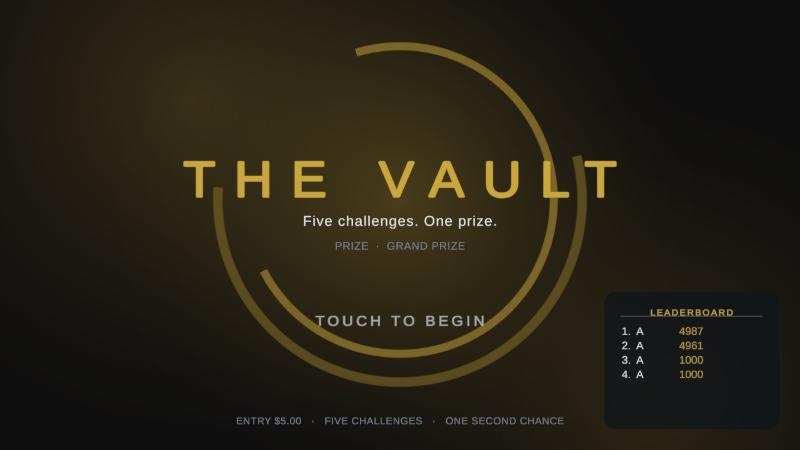
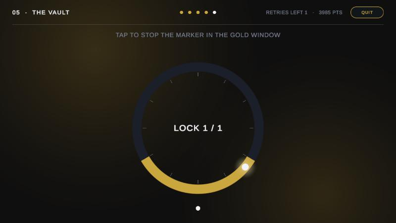
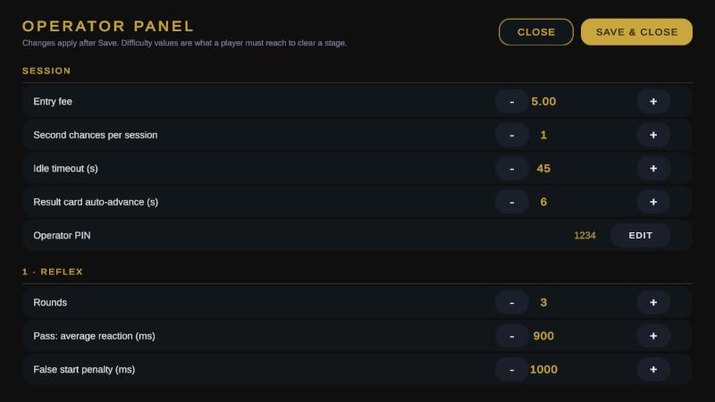

# THE VAULT — touchscreen skill-challenge prototype

A functional prototype of a premium, pay-to-play skill-challenge kiosk: a player pays an
entry fee, takes on five progressively harder challenges (reaction, precision, memory,
coordination, timing), and opens the vault if they clear all five.

Built in Unity 6 / C# for large Windows touchscreens; this repository also ships it as a
WebGL build so it can be tried in a browser.

**Try it:** https://chimpuchim.github.io/the-vault-demo/ — tap anywhere to start. Open the
operator panel by tapping the top-left corner five times (PIN `1234`). Best in a landscape
window; the first load downloads about 14 MB.





## What is in the prototype

- **Session flow** — attract/idle loop → payment → name entry → 5 stages → vault opens /
  stays locked → leaderboard → attract. Idle timeout returns to attract and records the
  session as abandoned.
- **Five challenges**, each measuring something different and returning a score (0–1000):

  | # | Challenge | Measures | Default pass rule |
  |---|-----------|----------|-------------------|
  | 1 | Reflex | reaction time (ms) | 3 rounds, average ≤ 450 ms; false start = 1000 ms |
  | 2 | Precision | touch offset from target centre (px) | 6 shrinking targets, average ≤ 30 px, ≤ 1 miss |
  | 3 | Recall | sequence memory | 3×3 grid, sequence grows 3 → 5, no mistakes |
  | 4 | Track | hand–eye coordination | finger on a moving orb ≥ 80 % of 12 s |
  | 5 | The Vault | timing + precision | stop the marker in the gold window, 3 locks, window narrows |

- **Second chance** — one retry per session (configurable).
- **Operator panel** — every difficulty value, session rule, prize, campaign name, tagline,
  currency and accent colour is editable on the device and saved locally; restore defaults,
  reset leaderboard, clear analytics.
- **Analytics** — one record per session (player, paid, outcome, every stage attempt with
  its metrics and duration). The panel shows completion rate, per-stage pass rates and
  average reaction / precision / coverage, and exports the raw JSON.
- **Leaderboard** — top 10, persisted on the device.
- **Payment seam** — the flow talks to an `IPaymentProvider`; the demo uses a mock
  tap-and-go terminal. An EFTPOS integration implements the same interface.
- **Branding** — campaign/prize/colour live in one config object, so a new activation is a
  config change, not a code change.

## Architecture

```
Bootstrap            the only scene object; creates the EventSystem and GameFlow
GameFlow             session state machine, owns config / leaderboard / analytics / payment
VaultConfig          defaults in code, admin edits saved as JSON (PlayerPrefs)
ChallengeBase        one class per challenge: Begin(config, area, onDone) -> ChallengeResult
  Reflex / Precision / Recall / Track / VaultDial
UIScreen + screens   attract, payment, name, intro, result, end, leaderboard, PIN, admin
UIFactory / Sprites  uGUI built in code from procedurally generated sprites (no art files)
AnalyticsStore       IAnalyticsSink; local store + summary + JSON export
IPaymentProvider     MockPaymentProvider (demo) / EFTPOS later
```

Everything is plain C# and one scene; there are no prefabs or scene wiring to maintain.
Adding a sixth challenge is one new class and one line in the stage table.

## Timing accuracy

Reaction time is measured from the frame the stimulus is drawn to the pointer-down event
using `Time.realtimeSinceStartupAsDouble` (about ±8 ms on a 60 Hz display). For the kiosk
build the next step is to read the Input System's hardware event timestamps and add a
per-screen display-latency calibration in the operator panel.

## Build

```bash
# WebGL (what the live demo runs)
unity build --target WebGL --execute-method Vault.EditorTools.VaultBuild.BuildWebGL -o Build/WebGL

# Windows touchscreen
unity build --target StandaloneWindows64 --execute-method Vault.EditorTools.VaultBuild.BuildWindows -o Build/Windows/TheVault.exe
```

The first build imports the TextMesh Pro essentials and creates the scene automatically.
Unity 6000.0.77f1, Universal RP, Input System, uGUI / TextMesh Pro.

## Status

Prototype. Not included yet: real payment terminal, server-side analytics, multi-language,
accessibility review, final art direction and sound design.
